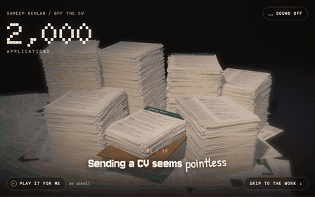
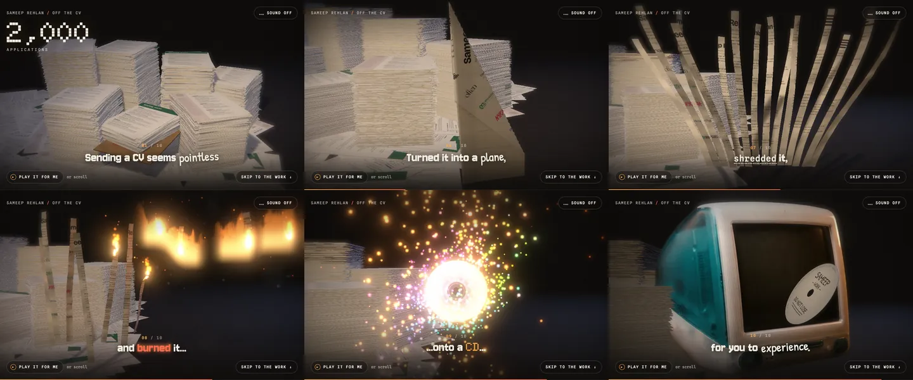
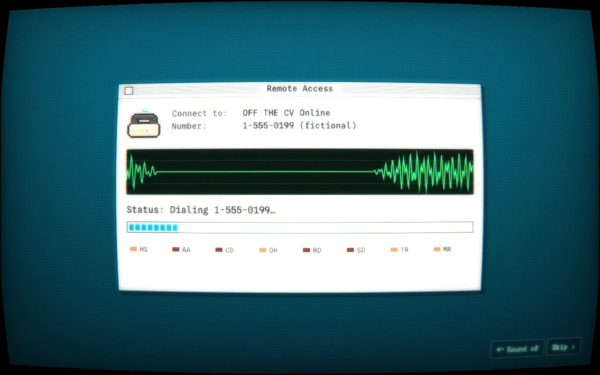
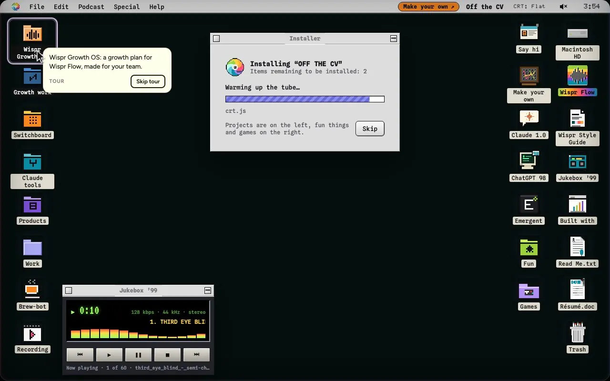
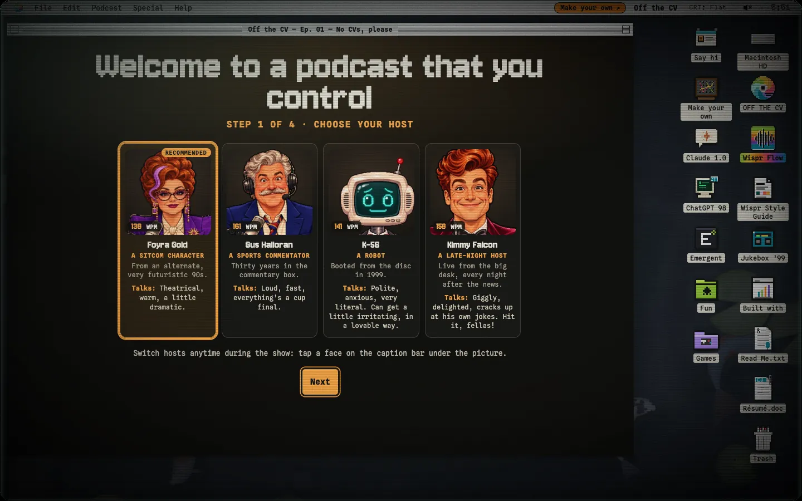
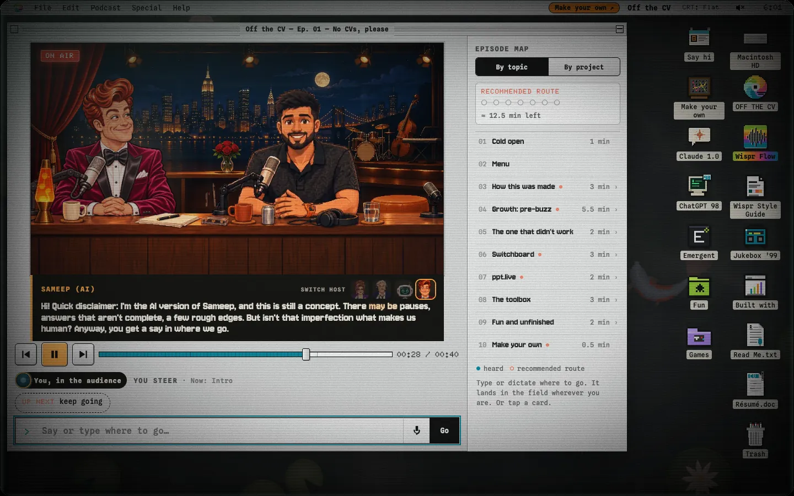
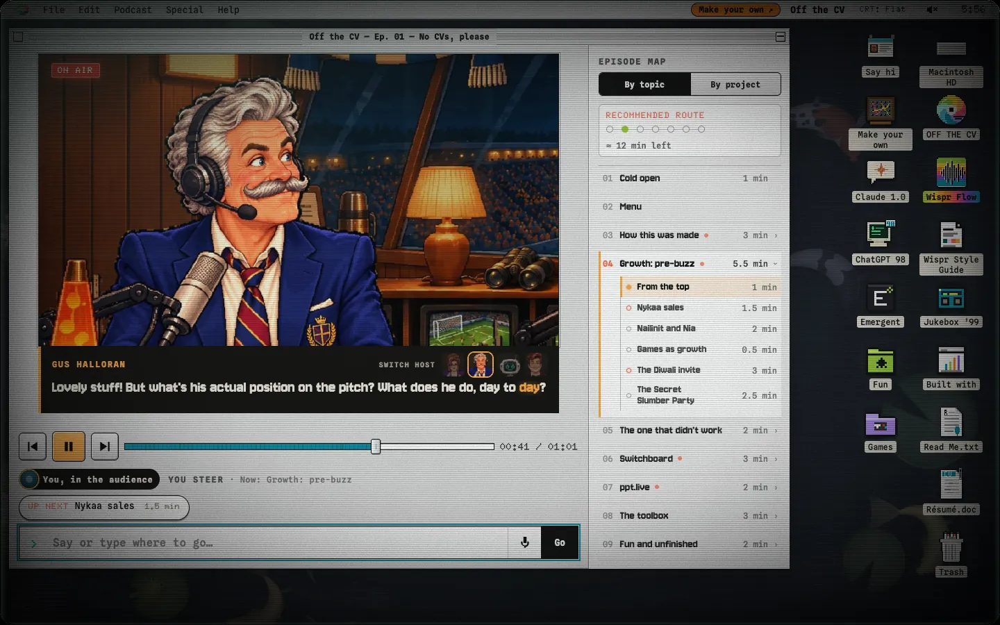
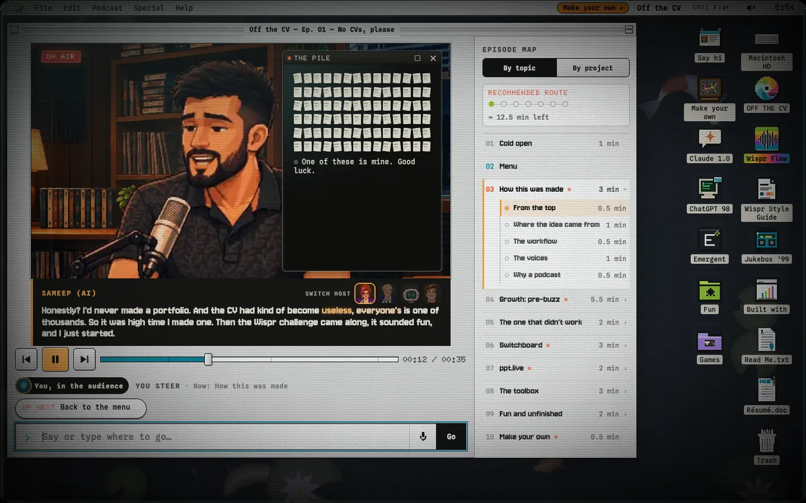
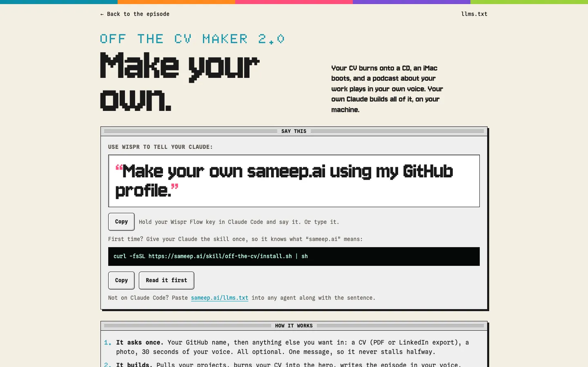
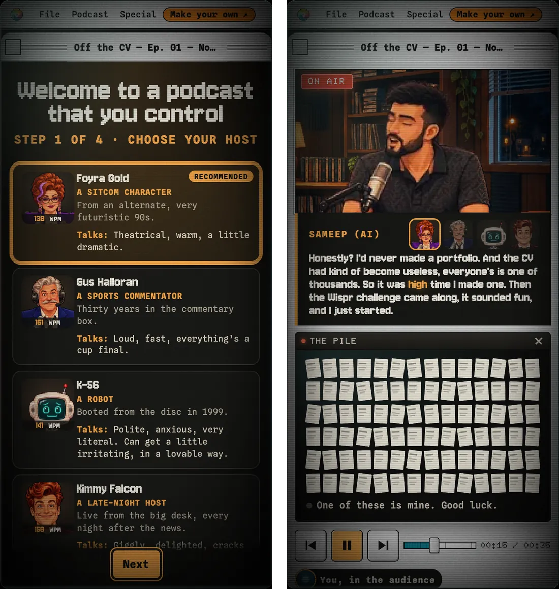

# sameep.ai

**A portfolio you talk to: a CV burned onto a CD that boots a 90s iMac and plays a choose-your-own-adventure podcast you steer with your voice.**

[**sameep.ai**](https://sameep.ai) · [make your own](https://sameep.ai/make)

<p align="center"></p>

<p align="center">
  
</p>

I'd never made a portfolio. A CV is one sheet in a pile of two thousand now, so this one starts by getting rid of it. You scroll, my CV gets folded into a plane, crumpled, shredded and burned onto a CD. The CD goes into a Bondi blue iMac, the modem dials up, and you land on a Mac OS 8 desktop with my work in folders. Open the podcast and a host interviews a pixel-art me, in my cloned voice. You pick where it goes by clicking a thread or just saying it out loud.

## What's inside

**The intro.** A three.js scene, scroll-scrubbed in 10 beats: the pile, the envelope, the plane, the crumple, the shred, the match, the burn, the CD, the iMac. "Play it for me" runs it on its own.

**The iMac.** It dials up at 56k (the modem noise is synthesised in your browser) and boots into a desktop: projects in folders on the left, toys and games on the right. The first time, a ghost cursor gives you the tour while it "installs".

<table>
  <tr>
    <td width="50%"></td>
    <td width="50%"></td>
  </tr>
</table>

**Off the CV, the podcast.** Pick a host, then steer. There are four: Foyra Gold, a sitcom character from a very futuristic 90s; Gus Halloran, a sports commentator who treats everything like a cup final; K-56, a robot booted off the disc in 1999; and Kimmy Falcon, a late-night host who cracks up at his own jokes. The hosts are made up, with synthetic voices. The guest is me, lip-synced. The subtitles do what Wispr Flow does: each line shows up as raw dictation, ums and all, then cleans itself up. The episode map on the right shows where you've been and what's left.

<p align="center"></p>

<table>
  <tr>
    <td width="50%"></td>
    <td width="50%"></td>
  </tr>
</table>

<p align="center"></p>

**Growth OS** (only in the Wispr version). A growth workspace I built for the Wispr team, behind an @wispr.ai sign-in: campaigns, creators, brand collabs, events and popups, a CRM, and the sources behind them.

**And the rest.** Case-study folders for the things I've built (Nykaa Pink Box, Nailinit's launch with Khushi Kapoor, the Secret Slumber Party, Often and Trippy, Switchboard, Brew-bot the voice-run coffee machine, and more), a jukebox, a Read Me, a Trash you can't empty. Plus [/make](https://sameep.ai/make).

<p align="center"></p>

It works on a phone too:

<p align="center"></p>

## How it was built

By voice, pretty much. I dictated the concept, the specs and most of the notes into **[Wispr Flow](https://wisprflow.ai)** and handed them to **[Emergent](https://emergent.sh)** and **Claude Code**, with a few sessions working in parallel off one plan. The podcast is drawn from those same dictations, which is why the AI version of me rambles the way I actually do.

The real numbers, straight from the logs (they're in [`data/build-stats.json`](data/build-stats.json)):

| | |
|---|---|
| Days | **4** (Friday night, 30 Oct, to 4 Nov 2026) |
| Claude Code sessions | **21**, up to **7** at once, plus 31 subagents |
| Prompts from me | **191** |
| Tool calls | **8,541** |
| Commits | **110** |
| Words dictated in Flow | **10,122**, about 78 minutes of talking, at **129 wpm** (fastest: 206) |
| Voice clips | **638**, 87 minutes of audio across 4 hosts |
| Lines of code | **16,422** |

At least 40% of the words in my prompts were spoken, not typed. That's a floor: Flow went on halfway through the week and hit its free word limit.

## Tech

- **Plain HTML, CSS and ES modules.** No framework, no build step. It's a static site.
- **[three.js](https://threejs.org)** for the intro: the pile, the paper sim, the shred, the fire, the CD, the iMac, with a post-processing pass.
- **A CRT shader** over the whole app: scanlines, phosphor triads, glow, and an optional curved tube that still takes clicks in the right place.
- **Pixel sprites with lip-sync.** Each line was run through whisper for word timings, then mapped to mouth shapes (`data/visemes.json`, `data/words.json`). The karaoke subtitles use the same timings.
- **Local TTS voices.** Every line was rendered on my laptop with [Kyutai Pocket TTS](https://huggingface.co/kyutai/pocket-tts) on MLX (my voice is a clone from a 20-second sample) and whisper-checked against the script. No cloud voice service.
- **Voice steering.** Say a thread out loud with Wispr Flow (or the browser mic) and a fuzzy matcher picks the choice.
- **Analytics** on a small Cloudflare Worker with D1. No IPs, no fingerprinting, and it's switched off in anyone else's copy.

## Make your own

Say "make your own sameep.ai using my GitHub profile" to your Claude or Emergent. That’s the whole thing.

- **[sameep.ai/make](https://sameep.ai/make)** walks you through it.
- **[`llms.txt`](llms.txt)** tells any agent how to build one.
- **[`skill/off-the-cv/`](skill/off-the-cv/)** is the Claude Code skill that does it end to end: reads your repos, writes the episode in your voice, makes your sprite, clones your voice locally, renders and checks every line, and deploys only when you say yes.

```sh
curl -fsSL https://sameep.ai/skill/off-the-cv/install.sh | sh
```

## Project structure

```
index.html          the shell: the intro, then the app inside the iMac
js/hero/            the three.js intro (pile, sheet, strips, CD, iMac, post-processing)
js/app/             CRT, boot, dial-up, desktop, window manager, the podcast, the tour
js/app/gos/         Growth OS
css/                styles
persona.json        who the show is about (swap it with ?persona=<url>)
data/episode.json   the podcast: a graph of nodes, lines, choices, `say` keywords, demos
data/               lip-sync, word timings, durations, build stats
audio/  img/        voice clips, music, sound effects, sprites, sets, the iMac
video/              project demo videos
<project>/          one folder per case study (brewbot/, pinkbox/, often/, ...)
growth-os/          Wispr Growth OS
make/               the Make your own page
skill/off-the-cv/   the Claude Code skill, its scripts and templates
llms.txt            instructions for agents
tools/  vendor/     small build helpers, three.js and a QR library
```

Run it locally with any static server:

```sh
python3 -m http.server 8000
```

Handy URL flags: `?skip` (straight to the iMac), `?mute`, `?fast` (skip the boot), `?tour` (replay the tour), `?debug&node=<node>` (jump to a podcast node).

## Licence

The **code** is [MIT](LICENSE). Fork it, take it apart, make your own. (The fine print is in [NOTICE.md](NOTICE.md).)

The **content isn't**. My voice clone, my face and likeness (including the pixel sprites of me), my CV, my case studies, the episode script and the photos and videos of my work are mine, and they're not licensed for reuse. If you fork it, swap them for your own. The skill does that for you.

## Credits

- Made by Sameep Rehlan. Dictated with [Wispr Flow](https://wisprflow.ai), built with [Emergent](https://emergent.sh) and [Claude Code](https://claude.com/claude-code).
- Voices: the hosts use preset voices from [Kyutai Pocket TTS](https://huggingface.co/kyutai/pocket-tts) via `pocket-tts-mlx`. Timings: whisper.
- [Switchboard](https://github.com/sameeeeeeep/switchboard) lends your own Claude and the on-device voice engine to the Make your own page.
- [three.js](https://threejs.org) (MIT), [qrcode-generator](https://github.com/kazuhikoarase/qrcode-generator) (MIT), [JSZip](https://stuk.github.io/jszip/) (MIT).
- Type from Google Fonts (SIL OFL): Jersey 10, Doto, Bricolage Grotesque, Spline Sans Mono, VT323, Patrick Hand.
- The desktop wallpaper is [wallpap.live](https://wallpap.live).
- Everything else, the icons, the studio, the cast, the sounds, was made for this project. No real logos were harmed.
